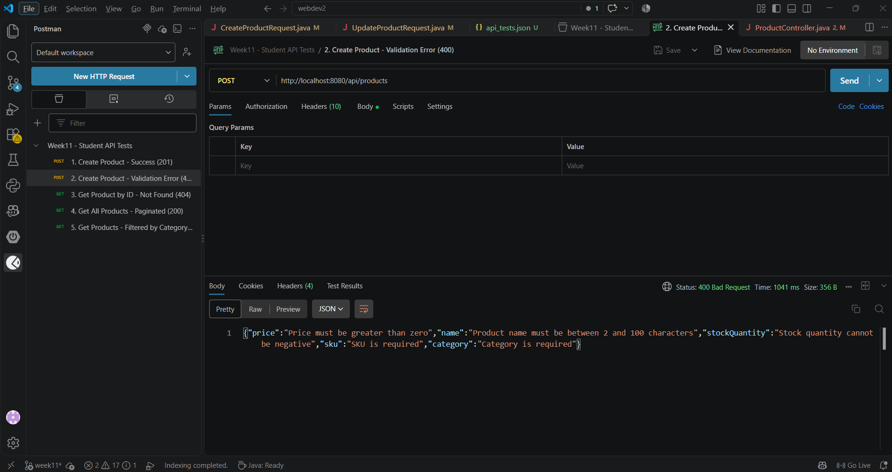
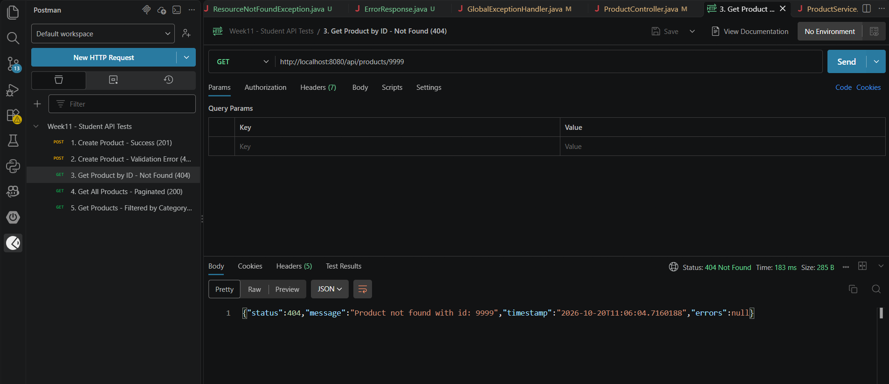
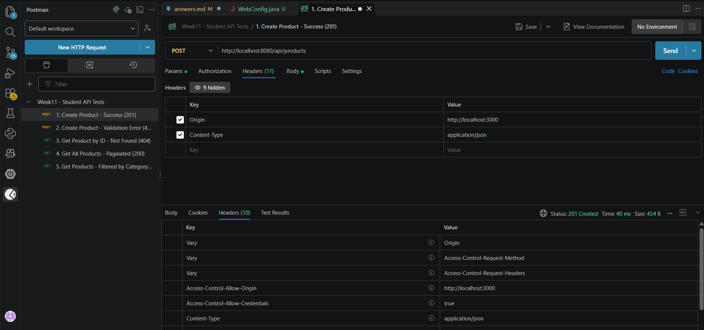
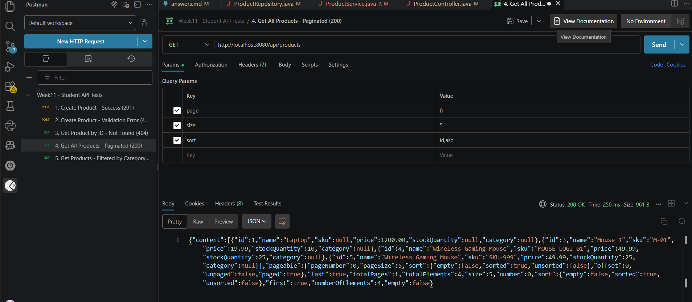
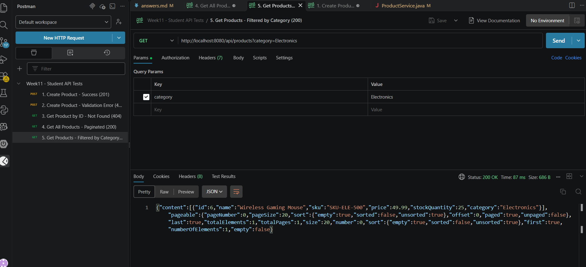
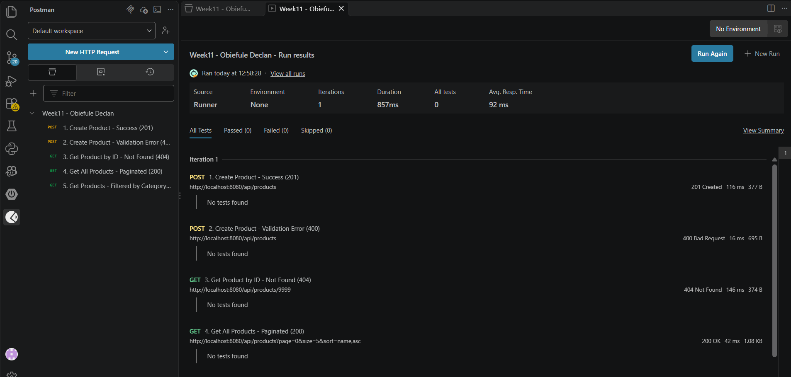
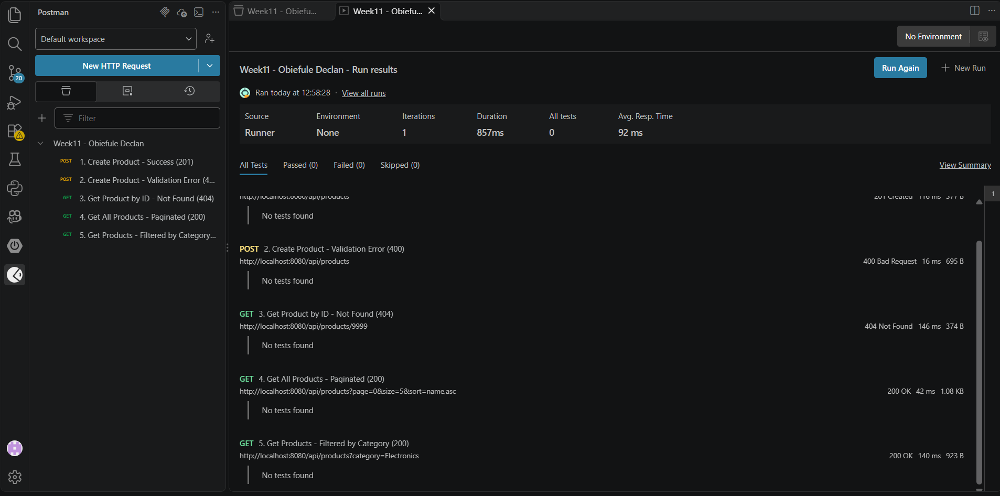

# WEBDEV2 — Week 11 Lab Answers

Name: OBIEFULE DECLAN
Student ID: 2510223
GitHub repo: https://github.com/sochimaobiefule-ship-it/webdev2
Date submitted: 20/10/2026

---

## Task 1 — Add Input Validation to Request DTOs

**Approach / explanation:**
I added Bean Validation annotations directly to the fields in my request DTO classes. To make sure Spring actually triggers these validations when a request comes in, I updated my controller methods to include `@Valid` right before the `@RequestBody` parameter.

**Code / endpoint(s) used (if applicable):**
```java
// Fields from CreateProductRequest DTO:
@NotBlank(message = "Product name is required")
@Size(min = 2, max = 100, message = "Product name must be between 2 and 100 characters")
private String name;

@NotBlank(message = "SKU is required")
private String sku;

@NotBlank(message = "Category is required")
private String category;

@NotNull(message = "Price is required")
@DecimalMin(value = "0.01", message = "Price must be greater than zero")
private BigDecimal price;

@NotNull(message = "Stock quantity is required")
@Min(value = 0, message = "Stock quantity cannot be negative")
private Integer stockQuantity;

// ProductController.java:
@PostMapping
public ResponseEntity<ProductResponseDTO> create(@Valid @RequestBody CreateProductRequest request) {
    return ResponseEntity.status(HttpStatus.CREATED).body(productService.create(request));
}
```

**Evidence (screenshot filename, request/response sample, or file reference in this folder):**


---

## Task 2 — Implement Global Exception Handling

**Approach / explanation:**
I implemented centralized exception handling using `@RestControllerAdvice` in `GlobalExceptionHandler`. I created a custom `ResourceNotFoundException` for missing entities and an `ErrorResponse` DTO to return structured JSON payload errors across the application instead of default Tomcat stack traces.

**Code / endpoint(s) used (if applicable):**
```java
// ResourceNotFoundException.java:
public class ResourceNotFoundException extends RuntimeException {
    public ResourceNotFoundException(String message) {
        super(message);
    }
}

// GlobalExceptionHandler.java:
@RestControllerAdvice
public class GlobalExceptionHandler {
    @ExceptionHandler(ResourceNotFoundException.class)
    public ResponseEntity<ErrorResponse> handleNotFound(ResourceNotFoundException ex) {
        ErrorResponse response = new ErrorResponse(
                HttpStatus.NOT_FOUND.value(),
                ex.getMessage(),
                LocalDateTime.now(),
                null
        );
        return ResponseEntity.status(HttpStatus.NOT_FOUND).body(response);
    }
}
```

**Evidence (screenshot filename, request/response sample, or file reference in this folder):**


---

## Task 3 — Enable CORS Configuration

**Approach / explanation:**
I created a global WebMvc configuration class annotated with `@Configuration`. It implements `WebMvcConfigurer` to configure CORS mappings for all `/api/**` endpoints. This allows cross-origin requests from common frontend dev servers using standard HTTP methods.

**Code / endpoint(s) used (if applicable):**
```java
@Configuration
public class WebConfig implements WebMvcConfigurer {
    @Override
    public void addCorsMappings(CorsRegistry registry) {
        registry.addMapping("/api/**")
                .allowedOrigins("http://localhost:3000", "http://localhost:5173")
                .allowedMethods("GET", "POST", "PUT", "DELETE", "OPTIONS")
                .allowedHeaders("*")
                .allowCredentials(true);
    }
}
```

**Evidence (screenshot filename, request/response sample, or file reference in this folder):**


---

## Task 4 — Implement Pagination and Filtering

**Approach / explanation:**
I updated the `getAll` controller method to accept Spring Data's `Pageable` parameter along with an optional `category` query parameter. In `ProductRepository`, I added `findByCategory(String category, Pageable pageable)`. The service checks if a category filter is provided; if so, it filters results by category, and otherwise returns a paginated list of all products.

**Code / endpoint(s) used (if applicable):**
```java
@GetMapping
public ResponseEntity<Page<ProductResponseDTO>> getAll(
        @RequestParam(required = false) String category,
        Pageable pageable) {
    return ResponseEntity.ok(productService.getAll(category, pageable));
}
```

**Evidence (screenshot filename, request/response sample, or file reference in this folder):**



---

## Task 5 — Document All Endpoints and Create a Test Collection

### 1. API Documentation Summary
The API endpoints have been fully documented in the `API.md` file. The documentation covers all CRUD operations on the `/api/products` resource, including required field validation, query parameters for pagination/filtering, response status codes, and example payloads.

### 2. Postman Test Collection
A Postman collection named `Week11 - Obiefule Declan` was created and exported to the project root as `api_tests.json`. The collection contains 5 core tests designed to verify both success and error paths:
1. `POST /api/products` — Happy path creation (returns `201 Created`).
2. `POST /api/products` — Request validation failure for invalid body (returns `400 Bad Request` with an `errors` array).
3. `GET /api/products/{id}` — Entity lookup failure for non-existent ID (returns `404 Not Found`).
4. `GET /api/products` — Paginated and sorted list request with `page`, `size`, and `sort` parameters (returns `200 OK`).
5. `GET /api/products` — Filtered list request with the `category` query parameter (returns `200 OK`).

### 3. Collection Runner Execution
The entire collection was executed using the Postman Collection Runner against the active Spring Boot backend server. All 5 requests executed successfully and passed with their expected HTTP status codes.


**Evidence (screenshot filename, request/response sample, or file reference in this folder):**

                

---

## Self-Check

- [ ] All Week 11 work on the `week11` branch (project at branch root, no `week11/` folder)
- [ ] This file completed and renamed `answers.md`
- [ ] Repository link pasted into Moodle (no files uploaded)