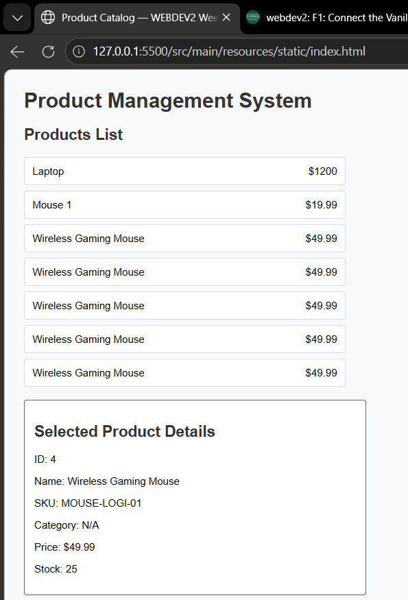
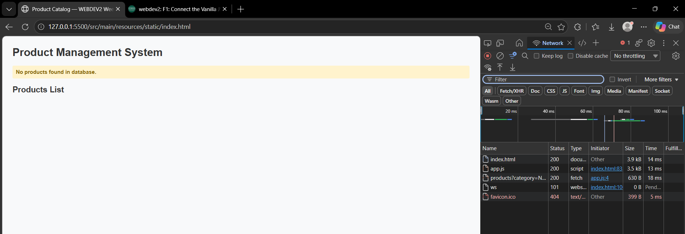
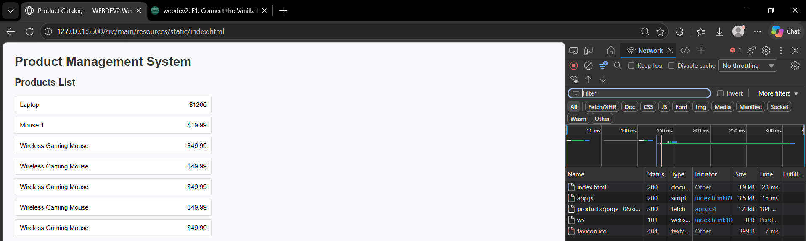
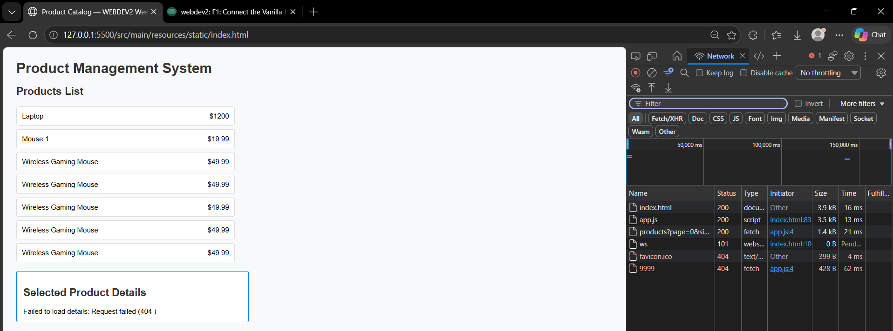
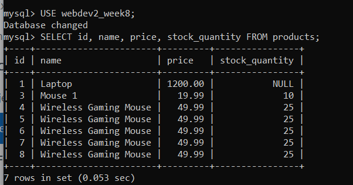

# WEBDEV2 — Week 13 Answers: Vanilla JS Frontend Integration

Name: OBIEFULE DECLAN
Student ID: 2510223
GitHub repo: https://github.com/sochimaobiefule-ship-it/webdev2
Date submitted: 12/11/2026

---

## Task 1 — Decoupling Architecture & API Contract

**Approach / explanation:**  
I integrated the Vanilla JS frontend with the Spring Boot backend using explicit REST boundaries. The browser sends GET requests to fetch paginated `ProductResponseDTO` records without communicating directly with the database or relying on backend template engines.

**Code / endpoint(s) used:**
```java
@GetMapping
public ResponseEntity<Page<ProductResponseDTO>> getAll(
        @RequestParam(required = false) String category,
        Pageable pageable) {
    return ResponseEntity.ok(productService.getAll(category, pageable));
}
```

## Task 2 — Fetch Helper & Safe Rendering

**Approach / explanation:** 
I implemented a centralized getJson() async function to wrap fetch() calls and throw human-readable HTTP failure messages. To protect against potential XSS attacks from database content, all dynamic text elements are assigned using .textContent instead of .innerHTML.

**Code / endpoint(s) used:**
```java script
async function getJson(path) {
  const response = await fetch(`${API_BASE}${path}`);
  if (!response.ok) {
    throw new Error(`Request failed (${response.status})`);
  }
  return response.json();
}
```

## Task 3 — Origin & CORS Audit

**Approach / explanation:**
I configured CORS settings inside WebConfig.java to explicitly permit origin http://127.0.0.1:5500 (Live Server) to query http://localhost:8080. allowCredentials was set to false for unauthenticated endpoints.

**Code / endpoint(s) used:**
```java
@Configuration
public class WebConfig implements WebMvcConfigurer {
    @Override
    public void addCorsMappings(CorsRegistry registry) {
        registry.addMapping("/api/**")
                .allowedOrigins(
                    "http://localhost:5500",
                    "http://127.0.0.1:5500",
                    "http://localhost:8080"
                )
                .allowedMethods("GET", "POST", "PUT", "DELETE", "OPTIONS")
                .allowedHeaders("*")
                .allowCredentials(false);
    }
}
```

## Task 4 — Database & DTO Alignment

**Approach / explanation:**
I verified that product records returned by /api/products directly align with SQL records stored in the webdev2_week8 MySQL database. Lazy-loaded associations in related domain tables are mapped within service boundaries to ensure clean responses.

**Code / endpoint(s) used:**
```sql
mysql> SELECT id, name, price, stock_quantity FROM products;
```
---











## Self-Check
- [] All Week 13 work committed to week13 branch
- [] Frontend served via HTTP (Live Server or Spring static resources)
- [] answers.md updated at branch root
- [] Documentation added under docs/week13/