# WEBDEV2 — Week 14 Answers: Full-Stack CRUD & Atomic Order Workflow

Name: OBIEFULE DECLAN
Student ID: 2510223
GitHub repo: https://github.com/sochimaobiefule-ship-it/webdev2
Date submitted: 12/11/2026

---

## Task 1 — Full Browser CRUD & Stateful Form Lifecycle

**Approach / explanation:**  
I extended the Vanilla JS frontend and Spring Boot REST API to support complete Create, Read, Update, and Delete workflows for both `Product` (`/api/products`) and `User` (`/api/users`). A single form per resource switches dynamically between `POST` (create) and `PUT` (update) using a hidden ID field, disables submit buttons while requests are in flight to prevent duplicate submissions, preserves user input when validation fails (`400`/`404`/`409`), and renders all server values safely via `.textContent`.

**Code / endpoint(s) used:**
```javascript
async function request(path, options = {}) {
    const response = await fetch(`${API_BASE}${path}`, {
        headers: { "Content-Type": "application/json", ...(options.headers || {}) },
        ...options,
    });

    if (response.status === 204) return null;

    let data = null;
    try {
        data = await response.json();
    } catch {
        data = null;
    }

    if (!response.ok) {
        throw new Error(data?.message || `Request failed (${response.status})`);
    }
    return data;
}
```

## Task 2 — Referential Integrity & Global Exception Handling

**Approach / explanation:**
I implemented GlobalExceptionHandler and domain validation rules across ProductService and UserService so duplicate SKUs/usernames return 400 Bad Request, missing records return 404 Not Found, and attempting to delete a Product or User referenced by existing orders is blocked with 409 Conflict instead of an unhandled database constraint failure.

**Code / endpoint(s) used:**
```java
@DeleteMapping("/{id}")
public ResponseEntity<Void> delete(@PathVariable Long id) {
    userService.delete(id);
    return ResponseEntity.noContent().build();
}
```

## Task 3 — Atomic Multi-Entity Order Workflow (@Transactional)

**Approach / explanation:**
Rather than coordinating stock updates and order creation from separate browser requests, I implemented POST /api/orders inside a single server-side @Transactional service method (OrderService.placeOrder) using LockModeType.PESSIMISTIC_WRITE on the target Product. Stock deduction, server-side total calculation, and persistence of CustomerOrder and OrderItem commit together or roll back completely on failure.

**Code / endpoint(s) used:**
```java
@Transactional
public OrderResponseDTO placeOrder(OrderRequest request) {
    User user = userRepository.findById(request.getUserId())
            .orElseThrow(() -> new ResourceNotFoundException("User not found"));
    Product product = productRepository.findByIdForUpdate(request.getProductId())
            .orElseThrow(() -> new ResourceNotFoundException("Product not found"));

    if (product.getStockQuantity() < request.getQuantity()) {
        throw new IllegalArgumentException("Insufficient stock available");
    }

    product.setStockQuantity(product.getStockQuantity() - request.getQuantity());
    productRepository.save(product);

    if (Boolean.TRUE.equals(request.getSimulateFailure())) {
        throw new RuntimeException("Simulated post-write failure to verify rollback");
    }

    CustomerOrder order = new CustomerOrder();
    order.setUser(user);
    order.setOrderDate(LocalDate.now());
    order.setStatus("CONFIRMED");

    OrderItem item = new OrderItem();
    item.setOrder(order);
    item.setProduct(product);
    item.setQuantity(request.getQuantity());
    item.setPrice(product.getPrice());
    order.getItems().add(item);

    CustomerOrder saved = orderRepository.save(order);
    return toDTO(saved, product.getStockQuantity());
}
```

## Task 4 — End-to-End Database & Transaction Rollback Verification

**Approach / explanation:**
I verified all 10 end-to-end scenarios across the browser UI, DevTools Network/Console tabs, and the webdev2_week8 MySQL database—confirming that valid orders deduct stock and persist confirmed orders atomically, while simulated post-write failures (500) roll back both stock changes and order writes cleanly.

**Code / endpoint(s) used:**
```sql
mysql> SELECT id, name, stock_quantity FROM products; SELECT * FROM customer_orders;
```

---


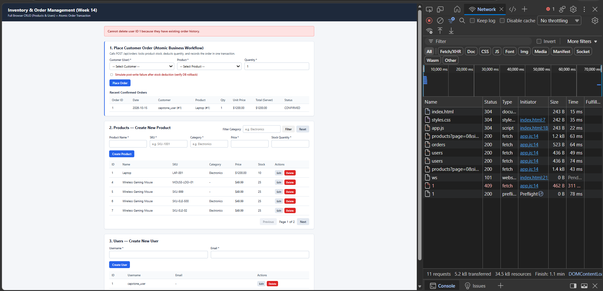

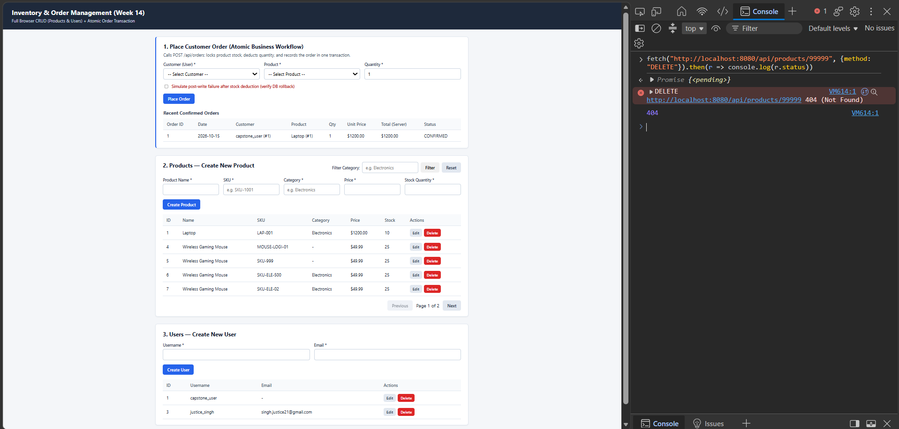

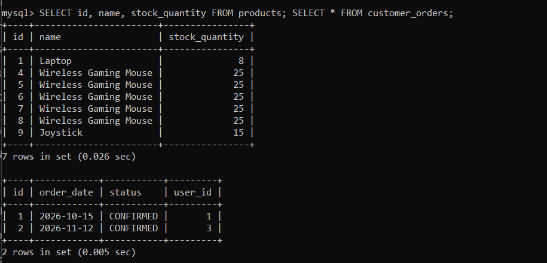

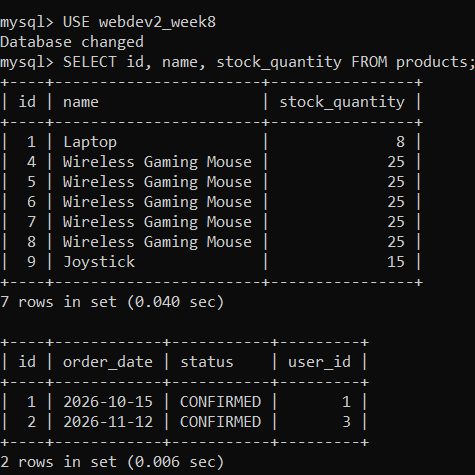

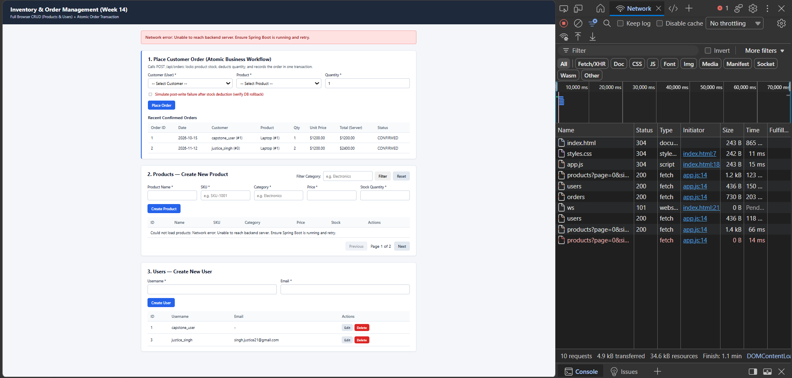

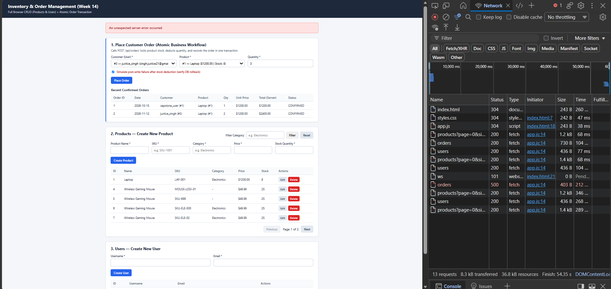

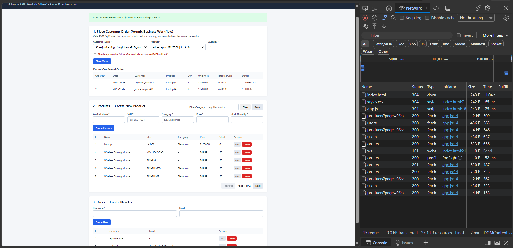

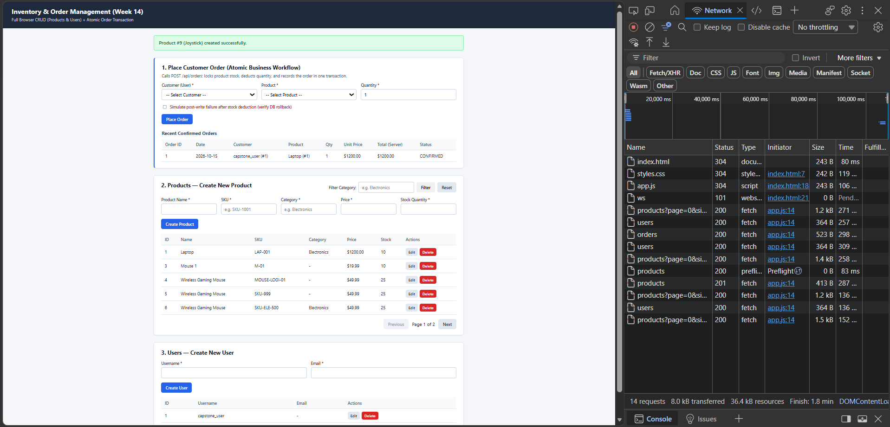

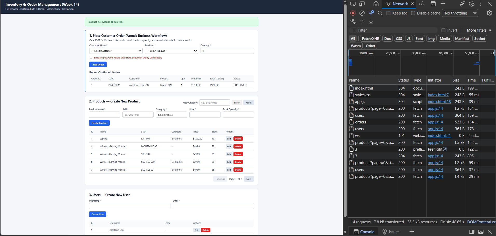

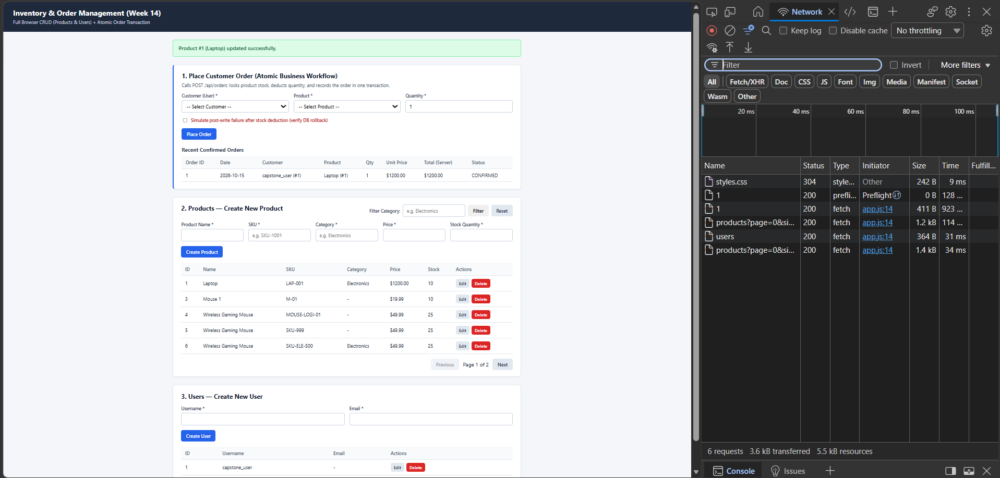

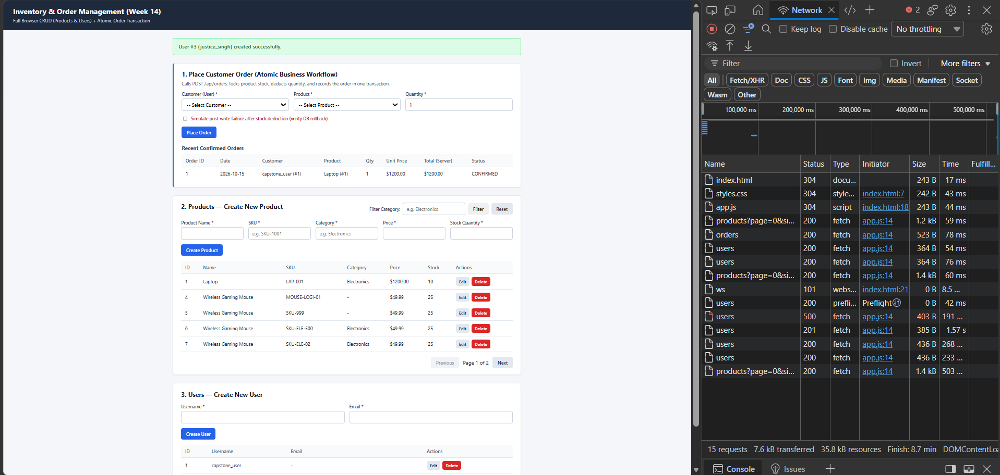

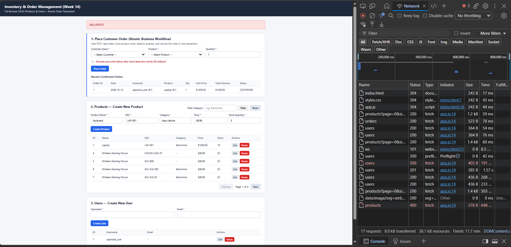


Self-Check
- [] All Week 14 work committed to week14 branch
- [] Full browser CRUD (Create, Read, Update, Delete) verified with live MySQL persistence
- [] Atomic @Transactional order workflow and rollback verified in UI and MySQL
- [] answers.md updated at branch root
- [] Documentation and test evidence added under docs/week14/