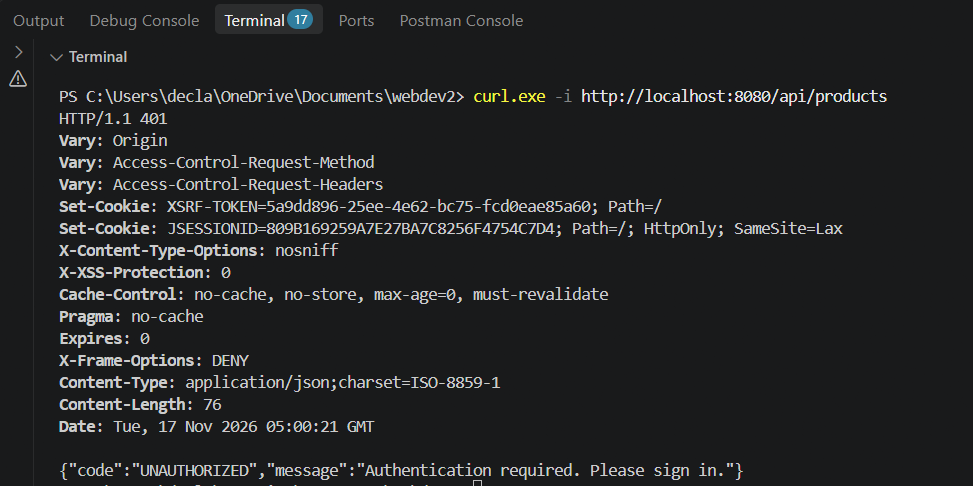
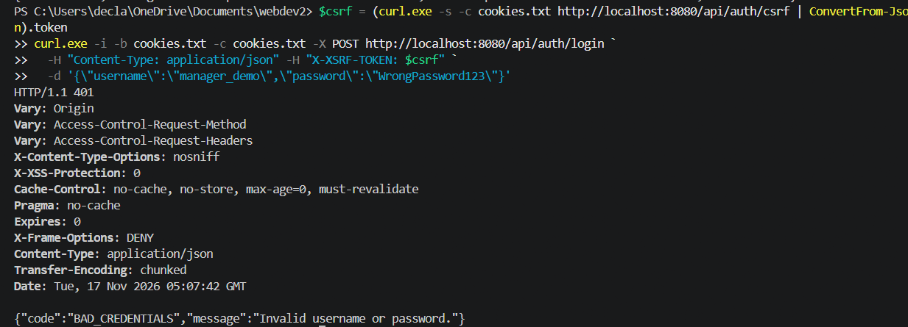
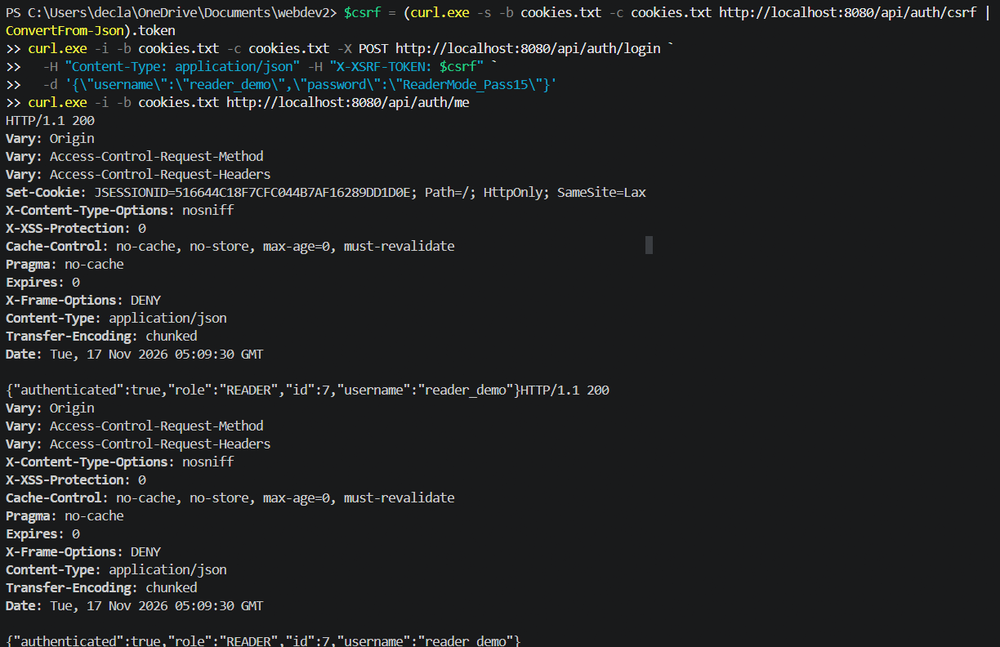
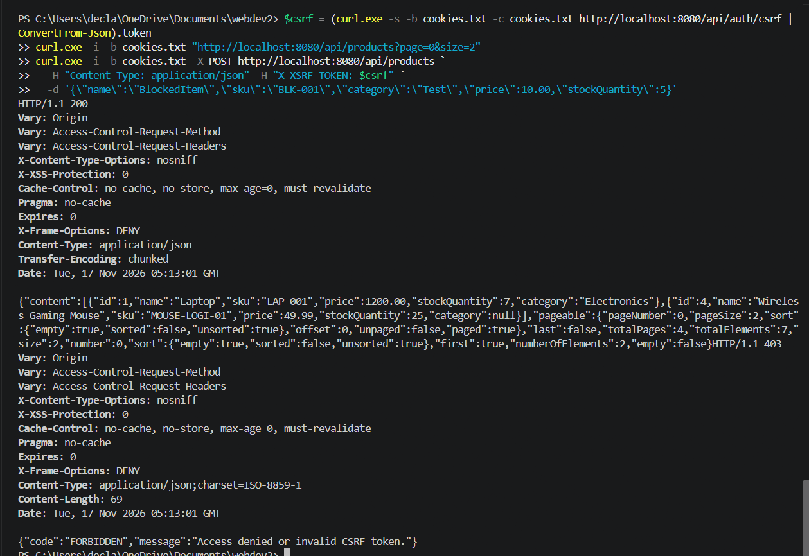
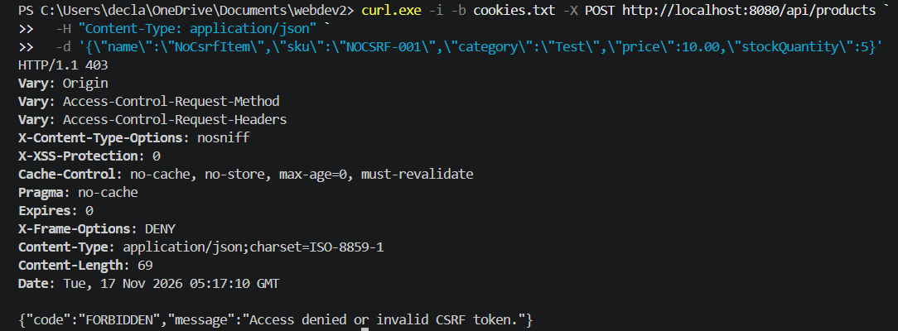
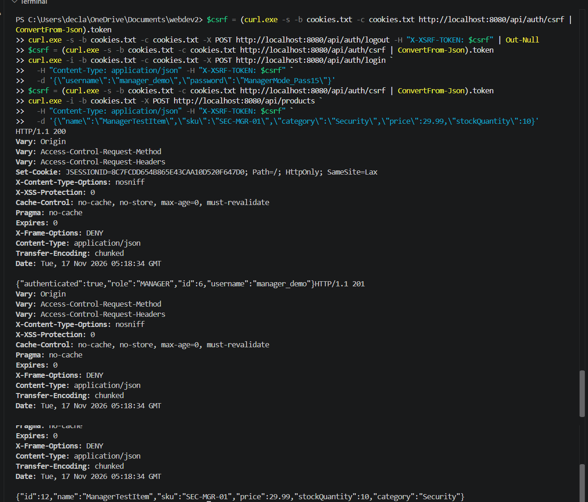
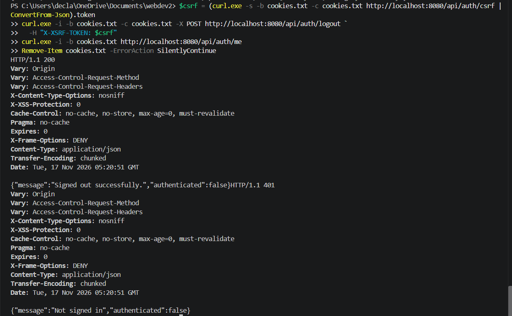
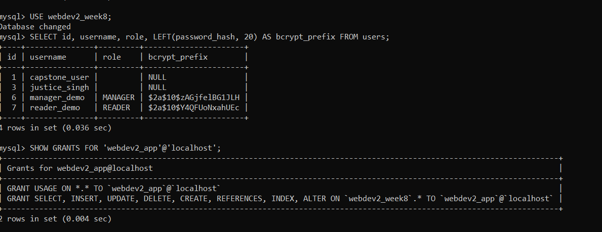

# Week 15 Security Verification & Test Suite (F3: Authentication, Authorization & Session Security)

**Project:** Inventory & Order Management System (`webdev2`)  
**Database Schema:** `webdev2_week8` (Least-Privilege DB User: `webdev2_app@localhost`)  
**Authentication Mechanism:** Stateful Server-Side Sessions (`JSESSIONID`, `HttpOnly`, `SameSite=Lax`) + Spring Security + BCrypt (`$2a$10$`) + Synchronizer CSRF Token (`X-XSRF-TOKEN`)  
**Test Execution Date:** 17/11/2026 

---

## Summary Matrix

| # | Test Scenario | Identity / Role | CSRF Context | Request | Expected Status | Actual Status |
|---|---|---|---|---|---|---|
| 1 | Unauthenticated API access rejected | Anonymous | N/A (`GET`) | `GET /api/products` | `401 Unauthorized` | `401 Unauthorized` |
| 2 | Invalid login credentials rejected | Anonymous (`manager_demo` + wrong pass) | Valid `X-XSRF-TOKEN` | `POST /api/auth/login` | `401 Unauthorized` | `401 Unauthorized` |
| 3 | Valid login issues session cookie & identity | `reader_demo` (`READER`) | Valid `X-XSRF-TOKEN` | `POST /api/auth/login` -> `GET /api/auth/me` | `200 OK` + `HttpOnly` cookie | `200 OK` |
| 4 | Role-based access control (`READER` read-only) | `reader_demo` (`READER`) | Valid `X-XSRF-TOKEN` | `GET /api/products` & `POST /api/products` | `200 OK` (`GET`) / `403 Forbidden` (`POST`) | `200 OK` / `403 Forbidden` |
| 5 | State-changing request without CSRF rejected | `reader_demo` (`READER`) | **Omitted** `X-XSRF-TOKEN` | `POST /api/products` | `403 Forbidden` | `403 Forbidden` |
| 6 | Privileged role (`MANAGER`) full write CRUD | `manager_demo` (`MANAGER`) | Valid `X-XSRF-TOKEN` | `POST /api/auth/login` -> `POST /api/products` | `200 OK` -> `201 Created` | `200 OK` -> `201 Created` |
| 7 | Logout invalidates server session | `manager_demo` -> Anonymous | Valid `X-XSRF-TOKEN` | `POST /api/auth/logout` -> `GET /api/auth/me` | `200 OK` -> `401 Unauthorized` | `200 OK` -> `401 Unauthorized` |
| 8 | BCrypt password storage & least-privilege DB | DBA / MySQL Audit | N/A (SQL) | `SELECT ... FROM users` & `SHOW GRANTS` | `$2a$10$` hashes & scoped grants | Verified |

---

## Detailed Test Cases, Exact Outputs & Inline Screenshots

### Test 1: Unauthenticated API Access Rejected (`401 Unauthorized`)
* **Identity / Role:** Anonymous (no active `JSESSIONID` cookie)
* **CSRF Context:** N/A (`GET` request)
* **Request:** `GET http://localhost:8080/api/products`
* **HTTP Status:** `401 Unauthorized`
* **Actual UI / API Result:** Unauthenticated request is intercepted by Spring Security and returns a structured JSON `401` payload (`UNAUTHORIZED`). In the UI, the login modal is displayed and protected product data remains inaccessible.

**Terminal Output (Redacted Tokens):**
```http
PS C:\Users\decla\OneDrive\Documents\webdev2> curl.exe -i http://localhost:8080/api/products
HTTP/1.1 401
Vary: Origin
Vary: Access-Control-Request-Method
Vary: Access-Control-Request-Headers
Set-Cookie: XSRF-TOKEN=[REDACTED_XSRF_TOKEN]; Path=/
Set-Cookie: JSESSIONID=[REDACTED_JSESSIONID]; Path=/; HttpOnly; SameSite=Lax
X-Content-Type-Options: nosniff
X-XSS-Protection: 0
Cache-Control: no-cache, no-store, max-age=0, must-revalidate
Pragma: no-cache
Expires: 0
X-Frame-Options: DENY
Content-Type: application/json;charset=ISO-8859-1
Content-Length: 76
Date: Tue, 17 Nov 2026 05:00:21 GMT

{"code":"UNAUTHORIZED","message":"Authentication required. Please sign in."}
```

**Screenshot Evidence:**


---

### Test 2: Invalid Login Credentials Rejected (`401 Unauthorized`)

* **Identity / Role:** Anonymous attempting `manager_demo` with an invalid password
* **CSRF Context:** Valid `X-XSRF-TOKEN` header retrieved from `GET /api/auth/csrf`
* **Request:** `POST http://localhost:8080/api/auth/login` with JSON `{"username":"manager_demo","password":"[REDACTED_WRONG_PASSWORD]"}`
* **HTTP Status:** `401 Unauthorized`
* **Actual UI / API Result:** BCrypt verification fails and returns `401` (`BAD_CREDENTIALS`) without issuing an authenticated session or leaking whether the username exists.

**Terminal Output (Redacted Password):**
```http
PS C:\Users\decla\OneDrive\Documents\webdev2> $csrf = (curl.exe -s -c cookies.txt http://localhost:8080/api/auth/csrf | ConvertFrom-Json).token
>> curl.exe -i -b cookies.txt -c cookies.txt -X POST http://localhost:8080/api/auth/login `
>>   -H "Content-Type: application/json" -H "X-XSRF-TOKEN: $csrf" `
>>   -d '{\"username\":\"manager_demo\",\"password\":\"[REDACTED_WRONG_PASSWORD]\"}'
HTTP/1.1 401 
Vary: Origin
Vary: Access-Control-Request-Method
Vary: Access-Control-Request-Headers
X-Content-Type-Options: nosniff
X-XSS-Protection: 0
Cache-Control: no-cache, no-store, max-age=0, must-revalidate
Pragma: no-cache
Expires: 0
X-Frame-Options: DENY
Content-Type: application/json
Transfer-Encoding: chunked
Date: Tue, 17 Nov 2026 05:07:42 GMT

{"code":"BAD_CREDENTIALS","message":"Invalid username or password."}
```

**Screenshot Evidence:**


---

### Test 3: Valid Login Issues `HttpOnly` Session Cookie & Identity (`200 OK`)

* **Identity / Role:** `reader_demo` (`READER`)
* **CSRF Context:** Valid `X-XSRF-TOKEN` header included
* **Requests:** `POST http://localhost:8080/api/auth/login` followed by `GET http://localhost:8080/api/auth/me`
* **HTTP Status:** `200 OK`
* **Actual UI / API Result:** Server authenticates `reader_demo`, issues `Set-Cookie: JSESSIONID=[REDACTED]; Path=/; HttpOnly; SameSite=Lax`, and `/api/auth/me` returns `{"authenticated":true,"role":"READER","id":7,"username":"reader_demo"}`.

**Terminal Output (Redacted Password & Session ID):**
```http
PS C:\Users\decla\OneDrive\Documents\webdev2> $csrf = (curl.exe -s -b cookies.txt -c cookies.txt http://localhost:8080/api/auth/csrf | ConvertFrom-Json).token
>> curl.exe -i -b cookies.txt -c cookies.txt -X POST http://localhost:8080/api/auth/login `
>>   -H "Content-Type: application/json" -H "X-XSRF-TOKEN: $csrf" `
>>   -d '{\"username\":\"reader_demo\",\"password\":\"[REDACTED]\"}'
>> curl.exe -i -b cookies.txt http://localhost:8080/api/auth/me
HTTP/1.1 200 
Vary: Origin
Vary: Access-Control-Request-Method
Vary: Access-Control-Request-Headers
Set-Cookie: JSESSIONID=[REDACTED_JSESSIONID]; Path=/; HttpOnly; SameSite=Lax
X-Content-Type-Options: nosniff
X-XSS-Protection: 0
Cache-Control: no-cache, no-store, max-age=0, must-revalidate
Pragma: no-cache
Expires: 0
X-Frame-Options: DENY
Content-Type: application/json
Transfer-Encoding: chunked
Date: Tue, 17 Nov 2026 05:09:30 GMT

{"authenticated":true,"role":"READER","id":7,"username":"reader_demo"}HTTP/1.1 200 
Vary: Origin
Vary: Access-Control-Request-Method
Vary: Access-Control-Request-Headers
X-Content-Type-Options: nosniff
X-XSS-Protection: 0
Cache-Control: no-cache, no-store, max-age=0, must-revalidate
Pragma: no-cache
Expires: 0
X-Frame-Options: DENY
Content-Type: application/json
Transfer-Encoding: chunked
Date: Tue, 17 Nov 2026 05:09:30 GMT

{"authenticated":true,"role":"READER","id":7,"username":"reader_demo"}
```

**Screenshot Evidence:**


---

### Test 4: Role-Based Access Control — `READER` Allowed `GET`, Blocked on `POST` (`403 Forbidden`)

* **Identity / Role:** `reader_demo` (`READER`)
* **CSRF Context:** Valid `X-XSRF-TOKEN` header included
* **Requests:** `GET http://localhost:8080/api/products?page=0&size=2` and `POST http://localhost:8080/api/products`
* **HTTP Status:** `200 OK` (`GET`) and `403 Forbidden` (`POST`)
* **Actual UI / API Result:** `READER` can browse paginated products (`200 OK`), while attempting to create a product (`POST /api/products`) is denied by RBAC (`403 Forbidden`). In the UI, product mutation controls are hidden for `READER`.

**Terminal Output:**
```http
PS C:\Users\decla\OneDrive\Documents\webdev2> $csrf = (curl.exe -s -b cookies.txt -c cookies.txt http://localhost:8080/api/auth/csrf | ConvertFrom-Json).token
>> curl.exe -i -b cookies.txt "http://localhost:8080/api/products?page=0&size=2"
>> curl.exe -i -b cookies.txt -X POST http://localhost:8080/api/products `
>>   -H "Content-Type: application/json" -H "X-XSRF-TOKEN: $csrf" `
>>   -d '{\"name\":\"BlockedItem\",\"sku\":\"BLK-001\",\"category\":\"Test\",\"price\":10.00,\"stockQuantity\":5}'
HTTP/1.1 200 
Vary: Origin
Vary: Access-Control-Request-Method
Vary: Access-Control-Request-Headers
X-Content-Type-Options: nosniff
X-XSS-Protection: 0
Cache-Control: no-cache, no-store, max-age=0, must-revalidate
Pragma: no-cache
Expires: 0
X-Frame-Options: DENY
Content-Type: application/json
Transfer-Encoding: chunked
Date: Tue, 17 Nov 2026 05:13:01 GMT

{"content":[{"id":1,"name":"Laptop","sku":"LAP-001","price":1200.00,"stockQuantity":7,"category":"Electronics"},{"id":4,"name":"Wireless Gaming Mouse","sku":"MOUSE-LOGI-01","price":49.99,"stockQuantity":25,"category":null}],"pageable":{"pageNumber":0,"pageSize":2,"sort":{"empty":true,"sorted":false,"unsorted":true},"offset":0,"unpaged":false,"paged":true},"last":false,"totalPages":4,"totalElements":7,"size":2,"number":0,"sort":{"empty":true,"sorted":false,"unsorted":true},"first":true,"numberOfElements":2,"empty":false}HTTP/1.1 403 
Vary: Origin
Vary: Access-Control-Request-Method
Vary: Access-Control-Request-Headers
X-Content-Type-Options: nosniff
X-XSS-Protection: 0
Cache-Control: no-cache, no-store, max-age=0, must-revalidate
Pragma: no-cache
Expires: 0
X-Frame-Options: DENY
Content-Type: application/json;charset=ISO-8859-1
Content-Length: 69
Date: Tue, 17 Nov 2026 05:13:01 GMT

{"code":"FORBIDDEN","message":"Access denied or invalid CSRF token."}
```

**Screenshot Evidence:**


---

### Test 5: State-Changing Request Without CSRF Token Rejected (`403 Forbidden`)

* **Identity / Role:** Authenticated session (`reader_demo`)
* **CSRF Context:** **Omitted** `X-XSRF-TOKEN` header
* **Request:** `POST http://localhost:8080/api/products` without `X-XSRF-TOKEN`
* **HTTP Status:** `403 Forbidden`
* **Actual UI / API Result:** Spring Security's CSRF filter blocks the state-changing `POST` request immediately with `403 Forbidden` when the `X-XSRF-TOKEN` header is missing.

**Terminal Output:**
```http
PS C:\Users\decla\OneDrive\Documents\webdev2> curl.exe -i -b cookies.txt -X POST http://localhost:8080/api/products `
>>   -H "Content-Type: application/json" `
>>   -d '{\"name\":\"NoCsrfItem\",\"sku\":\"NOCSRF-001\",\"category\":\"Test\",\"price\":10.00,\"stockQuantity\":5}'
HTTP/1.1 403 
Vary: Origin
Vary: Access-Control-Request-Method
Vary: Access-Control-Request-Headers
X-Content-Type-Options: nosniff
X-XSS-Protection: 0
Cache-Control: no-cache, no-store, max-age=0, must-revalidate
Pragma: no-cache
Expires: 0
X-Frame-Options: DENY
Content-Type: application/json;charset=ISO-8859-1
Content-Length: 69
Date: Tue, 17 Nov 2026 05:17:10 GMT

{"code":"FORBIDDEN","message":"Access denied or invalid CSRF token."}
```

**Screenshot Evidence:**


---

### Test 6: Privileged Role (`MANAGER`) Allowed Full Write Operations (`200 OK` / `201 Created`)

* **Identity / Role:** `manager_demo` (`MANAGER`)
* **CSRF Context:** Valid `X-XSRF-TOKEN` header included
* **Requests:** `POST http://localhost:8080/api/auth/login` followed by `POST http://localhost:8080/api/products`
* **HTTP Status:** `200 OK` (login) and `201 Created` (create product)
* **Actual UI / API Result:** `manager_demo` authenticates with `ROLE_MANAGER` (`id: 6`) and successfully inserts `ManagerTestItem` (`id: 12`, `sku: "SEC-MGR-01"`) into MySQL.

**Terminal Output (Redacted Password & Session ID):**
```http
PS C:\Users\decla\OneDrive\Documents\webdev2> $csrf = (curl.exe -s -b cookies.txt -c cookies.txt http://localhost:8080/api/auth/csrf | ConvertFrom-Json).token
>> curl.exe -s -b cookies.txt -c cookies.txt -X POST http://localhost:8080/api/auth/logout -H "X-XSRF-TOKEN: $csrf" | Out-Null
>> $csrf = (curl.exe -s -b cookies.txt -c cookies.txt http://localhost:8080/api/auth/csrf | ConvertFrom-Json).token
>> curl.exe -i -b cookies.txt -c cookies.txt -X POST http://localhost:8080/api/auth/login `
>>   -H "Content-Type: application/json" -H "X-XSRF-TOKEN: $csrf" `
>>   -d '{\"username\":\"manager_demo\",\"password\":\"[REDACTED]\"}'
>> $csrf = (curl.exe -s -b cookies.txt -c cookies.txt http://localhost:8080/api/auth/csrf | ConvertFrom-Json).token
>> curl.exe -i -b cookies.txt -X POST http://localhost:8080/api/products `
>>   -H "Content-Type: application/json" -H "X-XSRF-TOKEN: $csrf" `
>>   -d '{\"name\":\"ManagerTestItem\",\"sku\":\"SEC-MGR-01\",\"category\":\"Security\",\"price\":29.99,\"stockQuantity\":10}'
HTTP/1.1 200 
Vary: Origin
Vary: Access-Control-Request-Method
Vary: Access-Control-Request-Headers
Set-Cookie: JSESSIONID=[REDACTED_JSESSIONID]; Path=/; HttpOnly; SameSite=Lax
X-Content-Type-Options: nosniff
X-XSS-Protection: 0
Cache-Control: no-cache, no-store, max-age=0, must-revalidate
Pragma: no-cache
Expires: 0
X-Frame-Options: DENY
Content-Type: application/json
Transfer-Encoding: chunked
Date: Tue, 17 Nov 2026 05:18:34 GMT

{"authenticated":true,"role":"MANAGER","id":6,"username":"manager_demo"}HTTP/1.1 201 
Vary: Origin
Vary: Access-Control-Request-Method
Vary: Access-Control-Request-Headers
X-Content-Type-Options: nosniff
X-XSS-Protection: 0
Cache-Control: no-cache, no-store, max-age=0, must-revalidate
Pragma: no-cache
Expires: 0
X-Frame-Options: DENY
Content-Type: application/json
Transfer-Encoding: chunked
Date: Tue, 17 Nov 2026 05:18:34 GMT

{"id":12,"name":"ManagerTestItem","sku":"SEC-MGR-01","price":29.99,"stockQuantity":10,"category":"Security"}
```

**Screenshot Evidence:**


---

### Test 7: Logout Invalidates Server Session (`200 OK` -> `401 Unauthorized`)

* **Identity / Role:** `manager_demo` transitioning to Anonymous
* **CSRF Context:** Valid `X-XSRF-TOKEN` header included on `POST /api/auth/logout`
* **Requests:** `POST http://localhost:8080/api/auth/logout` followed by `GET http://localhost:8080/api/auth/me`
* **HTTP Status:** `200 OK` (logout) and `401 Unauthorized` (subsequent `/api/auth/me`)
* **Actual UI / API Result:** Logout invalidates the server-side `JSESSIONID` (`{"message":"Signed out successfully.","authenticated":false}`), and replaying the cookie jar on `/api/auth/me` immediately returns `401` (`{"message":"Not signed in","authenticated":false}`).

**Terminal Output:**
```http
PS C:\Users\decla\OneDrive\Documents\webdev2> $csrf = (curl.exe -s -b cookies.txt -c cookies.txt http://localhost:8080/api/auth/csrf | ConvertFrom-Json).token
>> curl.exe -i -b cookies.txt -c cookies.txt -X POST http://localhost:8080/api/auth/logout `
>>   -H "X-XSRF-TOKEN: $csrf"
>> curl.exe -i -b cookies.txt http://localhost:8080/api/auth/me
>> Remove-Item cookies.txt -ErrorAction SilentlyContinue
HTTP/1.1 200 
Vary: Origin
Vary: Access-Control-Request-Method
Vary: Access-Control-Request-Headers
X-Content-Type-Options: nosniff
X-XSS-Protection: 0
Cache-Control: no-cache, no-store, max-age=0, must-revalidate
Pragma: no-cache
Expires: 0
X-Frame-Options: DENY
Content-Type: application/json
Transfer-Encoding: chunked
Date: Tue, 17 Nov 2026 05:20:51 GMT

{"message":"Signed out successfully.","authenticated":false}HTTP/1.1 401 
Vary: Origin
Vary: Access-Control-Request-Method
Vary: Access-Control-Request-Headers
X-Content-Type-Options: nosniff
X-XSS-Protection: 0
Cache-Control: no-cache, no-store, max-age=0, must-revalidate
Pragma: no-cache
Expires: 0
X-Frame-Options: DENY
Content-Type: application/json
Transfer-Encoding: chunked
Date: Tue, 17 Nov 2026 05:20:51 GMT

{"message":"Not signed in","authenticated":false}
```

**Screenshot Evidence:**


---

### Test 8: MySQL BCrypt Password Storage & Least-Privilege Database Account

* **Identity / Role:** Database Verification (`webdev2_week8`)
* **CSRF Context:** N/A (MySQL CLI audit)
* **Actual Database Result:** Active accounts (`manager_demo`, `reader_demo`) store salted BCrypt hashes prefixed with `$2a$10$` (no plaintext passwords), and `webdev2_app@localhost` holds restricted DML/DDL privileges scoped solely to `webdev2_week8.*` rather than global `root` access.

**MySQL Output (Redacted Hash Suffixes):**
```text
mysql> USE webdev2_week8;
Database changed
mysql> SELECT id, username, role, LEFT(password_hash, 20) AS bcrypt_prefix FROM users;
+----+---------------+---------+----------------------+
| id | username      | role    | bcrypt_prefix        |
+----+---------------+---------+----------------------+
|  1 | capstone_user |         | NULL                 |
|  3 | justice_singh |         | NULL                 |
|  6 | manager_demo  | MANAGER | $2a$10$zAGjfelBG1JLH |
|  7 | reader_demo   | READER  | $2a$10$Y4QFUoNxahUEc |
+----+---------------+---------+----------------------+
4 rows in set (0.036 sec)

mysql> SHOW GRANTS FOR 'webdev2_app'@'localhost';
+--------------------------------------------------------------------------------------------------------------------------+
| Grants for webdev2_app@localhost                                                                                         |
+--------------------------------------------------------------------------------------------------------------------------+
| GRANT USAGE ON *.* TO `webdev2_app`@`localhost`                                                                          |
| GRANT SELECT, INSERT, UPDATE, DELETE, CREATE, REFERENCES, INDEX, ALTER ON `webdev2_week8`.* TO `webdev2_app`@`localhost` |
+--------------------------------------------------------------------------------------------------------------------------+
2 rows in set (0.004 sec)
```

**Screenshot Evidence:**
