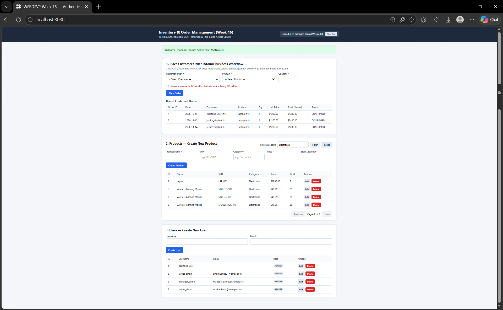
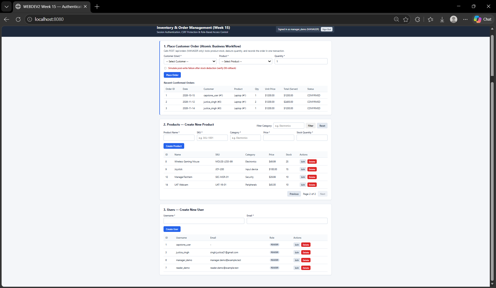
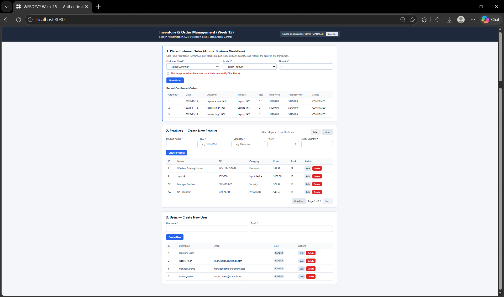
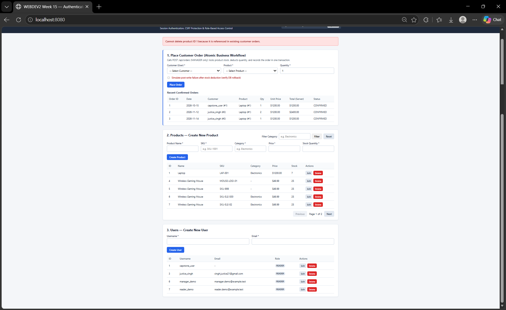
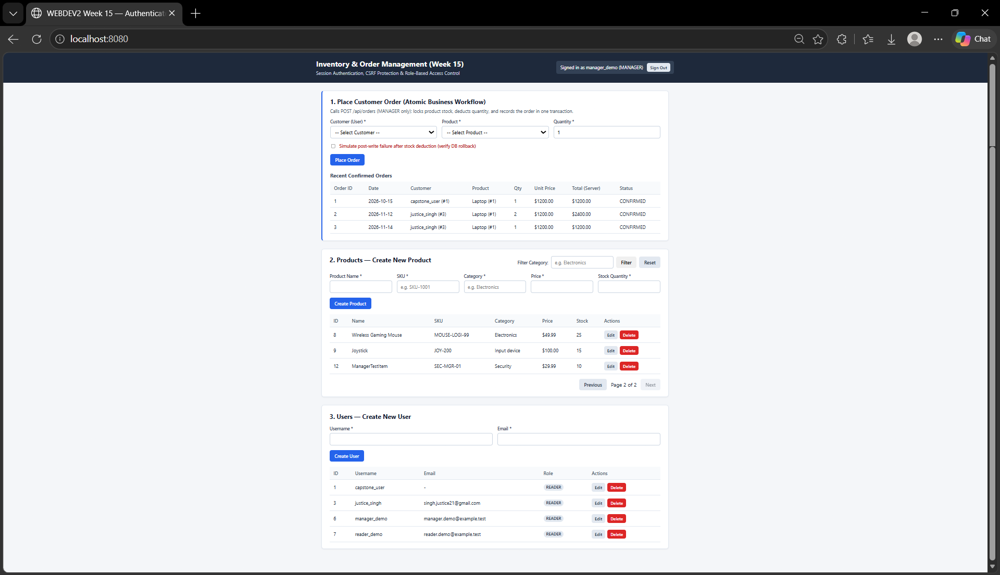
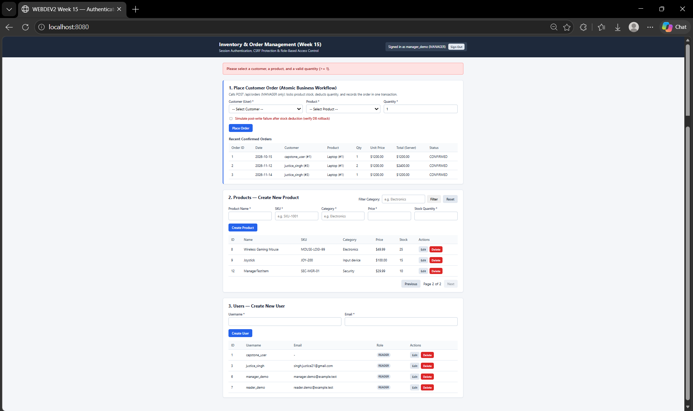
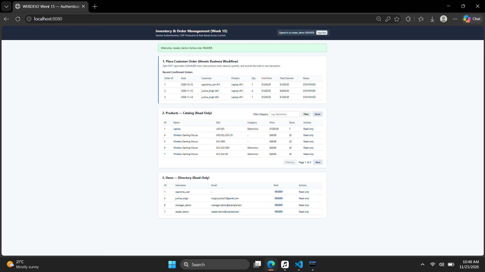
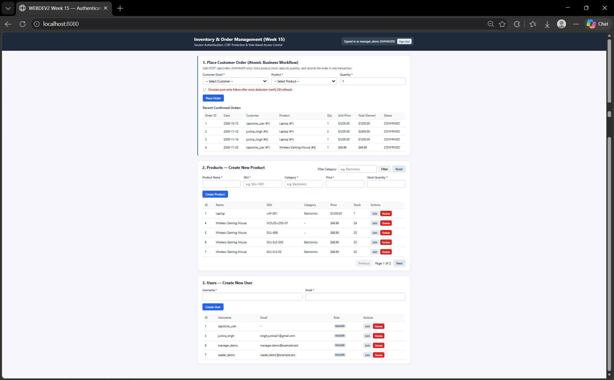
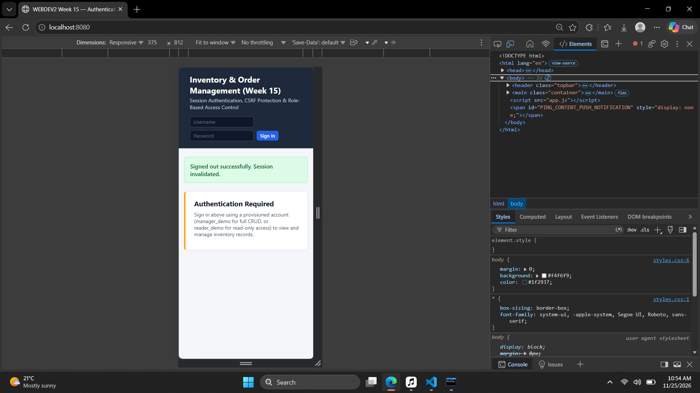

# Week 16 — F4: Tested Feature-Complete Application

**Date:** 25/11/2026  
**Stack & DB:** Spring Boot 3.2.3, Java 21, Spring Security, MySQL (`webdev2_week8` runtime / `webdev2_week16_test` test profile)  
**Verification Summary:** 13/13 automated tests passing (`BUILD SUCCESS`), 8/8 UAT flows verified, and `DEF-001` resolved.

---

## 1. Feature-Complete Checklist

- [x] **Automated Test Suite (`13/13` passing):** Verified `Week16MySqlTransactionTests` (2), `Week16ApiSecurityTests` (6), `Week16ServiceUnitTests` (4), and `Webdev2ApplicationTests` (1) with `BUILD SUCCESS`.
- [x] **UAT-01 — Manager Sign-In & Workspace:** Authenticated as `manager_demo` (`MANAGER`) on `http://localhost:8080` with CRUD controls enabled.
  
- [x] **UAT-02 — Category Filter, Reset & Pagination:** Filtered `Electronics` products, tested reset, and verified pagination controls.
  
- [x] **UAT-03 — Create Product & Reload Persistence:** Created `UAT Webcam` (`UAT-16-01`, `Peripherals`, `$45.00`, stock `10`) and confirmed persistence across full reload (`F5`).
  
- [x] **UAT-04 — Update Product & Reload Persistence:** Updated `UAT Webcam` (`UAT-16-01`) to `$49.50` and stock `16`, verifying persistence after `F5`.
  
- [x] **UAT-05 — Delete Policy (`409` Conflict vs. Unreferenced Delete):** Verified `409` conflict protection on order-referenced `Laptop` (ID `1`) and permanent deletion of unreferenced `UAT Webcam` (`UAT-16-01`) after reload.
  
  
- [x] **UAT-06 — Form Validation:** Verified clean validation error banner without stack traces on invalid order submission.
  
- [x] **UAT-07 — Read-Only Role (`reader_demo`):** Seeded `APP_SEED_READER_PASSWORD`, signed in as `reader_demo` (`READER`), and confirmed read-only UI and restricted write/delete actions.
  
- [x] **UAT-08 — Order Transaction, Mobile (`375x812`) & Keyboard:** Confirmed order transaction persistence and stock decrement (`25` -> `24`) after reload, plus `375x812` responsive viewport and keyboard navigation.
  
  
- [x] **DEF-001 Remediation & Verification:** Patched `UserResponseDTO.java` and `UserService.java` so `manager_demo` renders the `MANAGER` badge in the Users table.

## 2. Shared MySQL Evidence Reference (`INFOMAN1 week16/`)

Shared MySQL schema details, transaction commit/rollback logs, and database-level verification artifacts live under `INFOMAN1 week16/` instead of being duplicated in `docs/week16/evidence/`. Refer to `INFOMAN1 week16/` when checking SQL logs or shared database state.

## 3. Safe Configuration Examples

Use non-secret placeholder values in local shells or templates (never commit real passwords):

```properties
# Runtime environment placeholders (webdev2_week8 on port 3307)
DB_URL=jdbc:mysql://localhost:3307/webdev2_week8?useSSL=false&serverTimezone=UTC&allowPublicKeyRetrieval=true
DB_USERNAME=webdev2_app
DB_PASSWORD=<replace-with-local-db-password>
APP_SEED_MANAGER_PASSWORD=<replace-with-manager-password>
APP_SEED_READER_PASSWORD=<replace-with-reader-password>

# Automated test profile placeholders (test -> webdev2_week16_test)
TEST_DB_URL=jdbc:mysql://localhost:3307/webdev2_week16_test?useSSL=false&serverTimezone=UTC&allowPublicKeyRetrieval=true
TEST_DB_USERNAME=webdev2_app
```

## 4. Remaining Limitations & Notes
- Environment variable scoping: Shell environment variables (DB_PASSWORD, APP_SEED_MANAGER_PASSWORD, APP_SEED_READER_PASSWORD) apply only to the active terminal session and must be set before launching spring-boot:run if account re-seeding is required.

- Runtime reload: Backend Java changes (UserResponseDTO.java, UserService.java) require restarting the running Spring Boot process so the JVM loads updated classes.

- Test data persistence: Manual UAT records created in webdev2_week8 (such as Order ID 4 or test items) remain in the development database unless cleared manually.